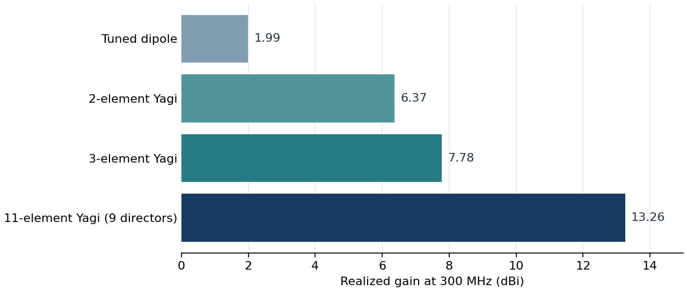
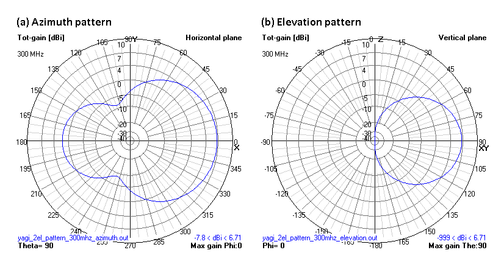

# 300 MHz Dipole and Yagi-Uda Antenna Study

[简体中文](README.zh-CN.md)

This project uses 4nec2/NEC-2 to tune a centre-fed dipole and then compare how a passive reflector and one or more directors change the antenna response. It includes four final designs, their editable wire models, the sweep scripts and the exported data.

**Result.** At 300 MHz the tuned dipole produced 1.99 dBi of simulated realized gain. The final 11-element Yagi with nine directors reached **13.26 dBi** with **−19.97 dB S11** and **12.15 dB front-to-back ratio**. Its −10 dB bandwidth was **18.27 MHz**, compared with **30.46 MHz** for the tuned dipole. The directional design trades matching bandwidth for greater forward gain.

## Compare the designs

| Model | S11 at 300 MHz | Realized gain | Front-to-back | −10 dB bandwidth |
| --- | ---: | ---: | ---: | ---: |
| [Tuned dipole](Part1/nec/dipole_final.nec) | −15.28 dB | 1.99 dBi | — | 30.46 MHz |
| [2-element Yagi](Part2/nec/yagi_2el_final.nec) | −11.26 dB | 6.37 dBi | 4.87 dB | 14.13 MHz |
| [3-element Yagi](Part3/nec/yagi_3el_final.nec) | −12.37 dB | 7.78 dBi | 10.74 dB | 12.73 MHz |
| [11-element Yagi](Part3/nec/yagi_9dir_best.nec) | −19.97 dB | 13.26 dBi | 12.15 dB | 18.27 MHz |

The Yagi figures use +x as forward and a 50 Ω reference for realized gain and S11. These are electromagnetic simulations. No fabricated antenna measurements are reported.

[Model geometry, calculations and sweep commands](docs/reproduce.md)
