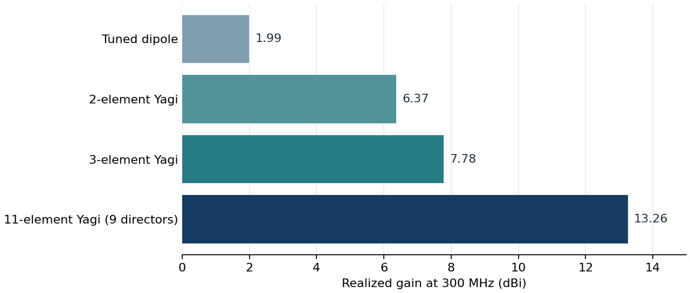
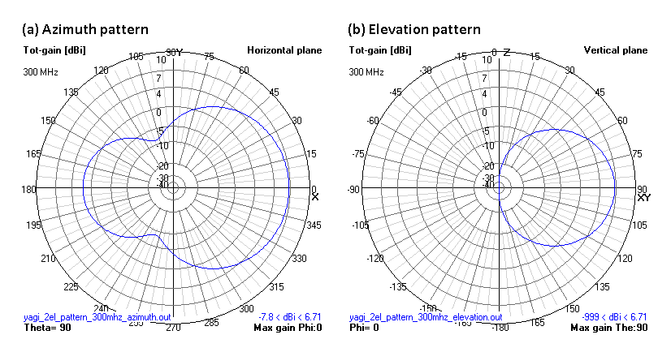

# 300 MHz 偶极子与八木天线仿真

[English](README.md)

项目用 4nec2/NEC-2 调谐中心馈电偶极子，逐步加入无源反射器与引向器，比较四种天线的方向性和匹配。仓库提供可编辑的线天线模型、扫参脚本与导出数据。

**结果。** 在 300 MHz 处，调谐偶极子的仿真实现增益为 1.99 dBi。最终的十一单元八木含九根引向器，实现增益达到 **13.26 dBi**，S11 为 **−19.97 dB**，前后比 **12.15 dB**。其 −10 dB 带宽为 **18.27 MHz**，而偶极子为 **30.46 MHz**。定向设计提高了前向增益，匹配带宽较窄。

## 设计对比

| 模型 | 300 MHz S11 | 实现增益 | 前后比 | −10 dB 带宽 |
| --- | ---: | ---: | ---: | ---: |
| [调谐偶极子](Part1/nec/dipole_final.nec) | −15.28 dB | 1.99 dBi | — | 30.46 MHz |
| [两单元八木](Part2/nec/yagi_2el_final.nec) | −11.26 dB | 6.37 dBi | 4.87 dB | 14.13 MHz |
| [三单元八木](Part3/nec/yagi_3el_final.nec) | −12.37 dB | 7.78 dBi | 10.74 dB | 12.73 MHz |
| [十一单元八木](Part3/nec/yagi_9dir_best.nec) | −19.97 dB | 13.26 dBi | 12.15 dB | 18.27 MHz |

八木天线以前向 +x 为比较方向，实现增益与 S11 使用 50 Ω 参考。上表来自电磁仿真，课程报告未记录成品天线实测结果。

[建模尺寸、计算与扫参命令](docs/reproduce.zh-CN.md)
